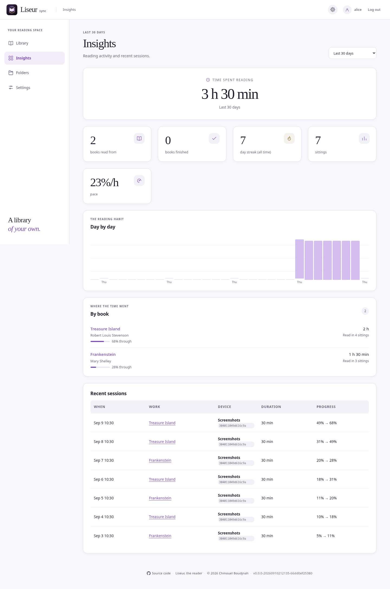
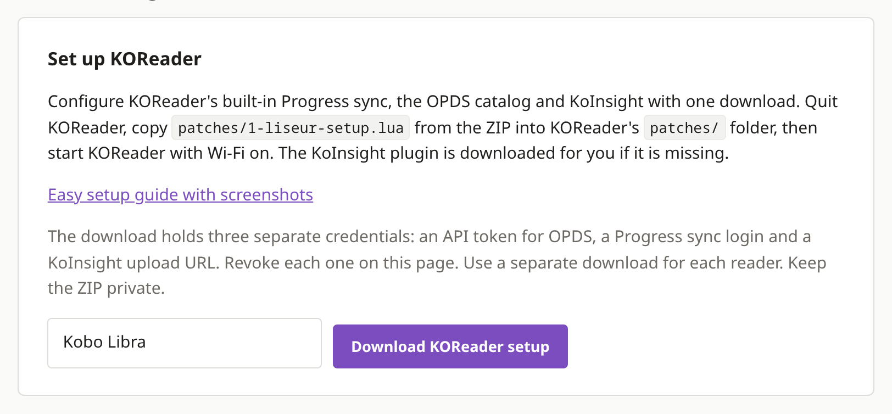
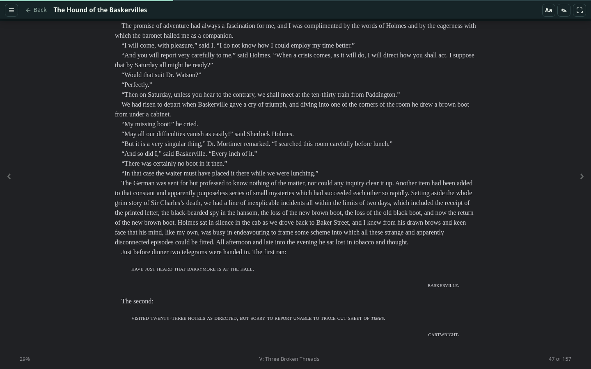

# liseur-sync

  

Self-hosted server for book libraries and reading-position synchronization.

`liseur-sync` is the companion server for [Liseur](https://github.com/chmouel/liseur). It also provides a kosync-compatible API for KOReader and CrossPoint.

The server is a single Go binary with SQLite by default, optional PostgreSQL, and multi-user support.

Project site: <https://chmouel.github.io/liseur-sync/>




## Set up KOReader

Download the setup from the Devices page, copy its plugin folders into KOReader's `plugins/` folder and start KOReader. The library appears in KOReader's built-in OPDS catalog, reading positions sync through its built-in Progress sync, and reading time goes to the server through the KoInsight plugin, which the setup downloads for you.

**[Step-by-step guide with screenshots](https://chmouel.github.io/liseur-sync/koreader/)**



## Set up CrossPoint

On an Xteink running CrossPoint, pair CrossPoint Sync with a code from the Devices page to sync your reading position. Add the OPDS catalog with a library token to download books, and install the statistics plugin the Devices page builds for the reader to record reading time.

**[Step-by-step guide with screenshots](https://chmouel.github.io/liseur-sync/crosspoint/)**

## Interfaces

`liseur-sync` provides:

* reading-position synchronization using full locators
* a native REST API
* a kosync-compatible API for KOReader and [CrossPoint](docs/crosspoint.md), with paragraph-precise positions shared with Liseur
* OPDS 1.2 and OPDS 2.0 catalogs
* EPUB library indexing and search
* audiobooks found in watched folders, played inside the web reader
* EPUB and audiobook upload, and deletion, for writable folders
* a browser based EPUB reader that supports offline reading.
* per-user reading statistics and sessions
* optional [Audiobookshelf chapter and listening sync](docs/deployment.md#following-an-audiobook-on-audiobookshelf)
* optional mirroring of an account's positions to another server
* per-user series claims
* a per-account sentence translation cache.

API documentation is available in [docs/openapi.yaml](docs/openapi.yaml).

Client implementation notes and the synchronization protocol are documented in [docs/integrating.md](docs/integrating.md).

## Reading synchronization

Reading-position updates are stored as an append-only log rather than replacing the previous position.

This allows the server to resolve updates from multiple devices without an older client blindly replacing newer state. The same history is used to derive reading sessions and statistics.

Book identity is independent of its filesystem path. Clients can resolve books using content and metadata identifiers, including hashes, before exchanging reading state.

Reader preferences synchronize as well per device.

### Clients

Every device writes positions its own way, and the server keeps them together:

* **KOReader** syncs positions through its built-in *Progress sync*, browses the library over OPDS and uploads reading time with the KoInsight plugin. One download from the Devices page sets all three up: see the [setup guide](https://chmouel.github.io/liseur-sync/koreader/) or the [reference](docs/koreader.md).
* **CrossPoint** pairs through kosync; see [docs/crosspoint.md](docs/crosspoint.md).
* **Liseur**, the Android app and the main client, uses the native API. See [how it connects](https://chmouel.github.io/liseur-sync/liseur/).

Pairing and setup for each client is in [docs/deployment.md](docs/deployment.md).

### Mirroring

If reading positions are also kept somewhere else, such as BookOrbit, a second `liseur-sync` or a plain KOReader sync server, a mirror can keep one account in step with it. It is off until an administrator configures it, each mirror covers exactly one account, and several peers can be named at once. See [docs/deployment.md](docs/deployment.md#mirroring-reading-to-another-server).

## Library

`liseur-sync` can index either:

* a directory containing EPUB files, with `.m4b` audiobooks beside them
* a Calibre library using `metadata.db`

Plain directories derive series information from their directory structure. Calibre libraries use `metadata.db` as the catalog source.

A book can also carry an audiobook: `.m4b` files are picked up from the same folders and paired with their EPUB, by directory, ISBN, ASIN or title and author. See [Audiobooks](#audiobooks).

Catalogs are exposed through the web UI, REST API, and OPDS.


### Folder access

Folders are granted to accounts individually. Adding a folder does not automatically make it visible to every account.

From the CLI:

```sh
liseur-sync admin add-folder -assign alice Shelf /srv/books
```

Folders can also be configured under:

```text
Settings > Administration > Folders
```

Account folder grants are managed under:

```text
Settings > Administration > Users
```

### Writable folders

Folders are read-only by default.

Uploads and deletions are only allowed for folders explicitly configured to accept uploads:

```sh
liseur-sync admin folder-uploads <folder-id> on
```

For API clients:

* `library-upload` permits adding books, and audiobooks, to writable folders
* `library-delete` permits removing books from writable folders

These are separate token scopes.

Deleting through the web UI requires an administrator account.

A folder that does not accept uploads remains read-only: the server indexes its contents but does not add or remove files from it.

See:

* [ADR-0023](docs/adr/0023-uploads-land-in-a-folder.md)
* [ADR-0025](docs/adr/0025-deleting-a-book.md)

## Web reader

`liseur-sync` includes a browser-based EPUB reader.



The reader uses the same synchronization API as other clients, so reading state is shared with Liseur, KOReader, CrossPoint, and other compatible clients.

When another device has read further, the reader offers to continue there, naming both pages, how long ago the other device was there, and the passage it had on screen. The same comparison can be asked for at any time with the sync button in the reader bar (`s`), which shows both positions and offers to take the other one, keep this page, or cancel and change nothing. The library and the offline shelf refresh on a pull-down, or with their refresh button: pending reading is delivered first, then the page is redrawn. See [ADR-0040](docs/adr/0040-asking-rather-than-waiting-to-be-asked.md).

EPUB content is unpacked and rendered without exposing publisher files through normal application routes. Scripts embedded in EPUBs are not executed.

The reader design and security model are documented in [ADR-0007](docs/adr/0007-web-reader.md), including support for running the reader on a separate hostname.

### Offline PWA

Liseur-sync's web UI ships as a PWA that lets you read books offline. Install
the site with your browser's "Add to Home Screen" option (Safari, Chrome, etc.),
open the installed app and sign in there, then choose **Save offline** for each
book you want to carry. Books saved in the browser beforehand do not carry over
to the installed app on iOS.
The installed app opens downloaded books without a network connection and keeps
positions, reading sessions, highlights and notes locally until it can
reconnect.

**[Install it on an iPad, step by step](https://chmouel.github.io/liseur-sync/ipad/)**

### Audiobooks

A book whose audiobook the server can find opens with a player in the reader: chapters, playback speed, and skip back and forward.

Listening is reading here, so the audiobook moves the same position a page turn does, and the page follows the narration while it plays. A single button turns following and the sentence highlight on and off, and the highlighting steps aside if you scroll away.

Following lands on the right chapter from the audiobook's own chapters. To highlight the sentence actually being spoken, the server asks a speech-to-text service to listen a few seconds ahead. That part is optional, configured under `Settings > Administration > Speech-to-text`, and nothing about reading positions depends on it.

Audiobooks that live on an [Audiobookshelf](docs/deployment.md#following-an-audiobook-on-audiobookshelf) server can be followed from there instead of from a watched folder.

To add one, the book's details page accepts an `.m4b` in a folder that accepts uploads. It writes a new file next to the book and never replaces an audiobook already there.

See [ADR-0057](docs/adr/0057-native-watched-folder-audiobooks.md) and [ADR-0058](docs/adr/0058-uploading-an-audiobook-onto-a-book.md).

## Installation

### Install script

The installer supports Docker and rootless Podman.

```sh
curl -fsSL https://raw.githubusercontent.com/chmouel/liseur-sync/main/scripts/install.sh | bash
```

Alternatively:

```sh
git clone https://github.com/chmouel/liseur-sync.git
cd liseur-sync
scripts/install.sh
```

To install a specific version:

```sh
LISEUR_VERSION=vX.Y.Z scripts/install.sh
```

The installer configures the database, starts the server, and creates the initial account.

### Docker Compose

SQLite:

```sh
docker compose --profile sqlite up -d
```

Bundled PostgreSQL:

```sh
docker compose --profile postgres up -d
```

External PostgreSQL:

```sh
docker compose --profile external up -d
```

### Build from source

```sh
go tool templ generate ./internal/webui/
go build ./cmd/liseur-sync
./liseur-sync serve
```

## Initial setup

The web interface is available at:

```text
/ui/
```

When the database contains no accounts, the setup page creates the initial administrator account and can watch a first folder of books in the same step.

Users, folders, API tokens, folder grants, and reader pairing can be managed from the administration interface or with the `admin` CLI.

Deployment details, including TLS, KOReader pairing, Calibre integration, watched folders, and backups, are documented in [docs/deployment.md](docs/deployment.md).

## Client integration

[Liseur](https://github.com/chmouel/liseur) uses the native API.

Protocol and synchronization details:

[docs/integrating.md](docs/integrating.md)

OpenAPI specification:

[docs/openapi.yaml](docs/openapi.yaml)

## Security

Security issues should be reported according to [SECURITY.md](SECURITY.md).

Do not report security vulnerabilities through public GitHub issues.

## License

MIT.

The screenshots use public-domain editions from [Standard Ebooks](https://standardebooks.org) and are generated by `scripts/screenshots.sh`.
